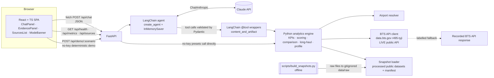

# Architecture & Scoring Design: Airport Investment Intelligence Agent

**Status: DRAFT, revision 2 (Phase 3), for review.**
- Items marked **[APPROVED]** cite a user-approved decision in NOTES.md.
- Items marked **[PROPOSED]** await approval.
- This document describes **design, not verified implementation**. No application code exists yet.
- It is finalized in Phase 9 (D-013).

**Revision history:**
- **Rev 1 (2026-10-30):** proposed a Python FastAPI backend, a plain HTML/JS UI, and a hand-written Claude tool loop (P-001, P-002).
- **Rev 2 (2026-10-30):** the user approved **React + TypeScript + Vite**, **Python + FastAPI**, and **LangChain** (D-022, D-023, D-024). P-001's UI part and P-002 are **superseded**, and the record is kept in NOTES.md §5. Also revised: numeric validation (P-019 replaces P-005), the time budget (P-020), demo mode (P-004 → P-021), and model selection (P-003 → P-022).
- **Rev 3 (2026-10-30):** design-review feedback. The following user decisions are now **APPROVED**:
  - D-028: all calculations in deterministic Python.
  - D-029: the 300-flight rule is a configurable *warning*, not an exclusion.
  - D-030: code-generated evidence rendered by React is preferred over scanning text.
  - D-031: the 24 h budget is a planning target with 3 h contingency.
  - D-032: no-key mode is a labelled deterministic demo only.
  - D-033: the model is configurable and verified in the Phase 4 smoke test, with a documented fallback.
  - D-034: a single FastAPI server for review, with the Vite proxy in dev.
  - D-035: Pydantic tool schemas, with LangChain behaviours confirmed in Phase 4.
  - D-036: `.gitignore` fix.
  - D-037: no snapshot commits before licensing and provenance checks.
  - D-038: update the plan after the remaining approvals.

  **Scoring (§7) stays PROPOSED pending review.**
- **Rev 4 (2026-10-30, Phase 3 closing):** further user decisions are now APPROVED:
  - **D-039:** scoring P-027 with option A (candidate-group min-max), the default weights, and the rules, subject to precise field definitions.
  - **D-040:** P-010 to P-018.
  - **D-041:** drop the text scanner P-026 and test artifact propagation instead.
  - **D-042:** LangChain tools with Pydantic validation (P-024) and in-memory sessions.
  - **D-043:** update implementation-plan.md now.
  - **D-044:** a time-boxed generic `aggregate_metrics` tool (direction approved; detailed design P-030 proposed).

  Precise field, denominator, and edge-case definitions (§6, §7.1b) are **P-029, for confirmation**. They are based on field checks run on 2026-10-30.

**Approved constraints carried in:**
- D-010 / D-011: investment indicators, not profitability; the goal is unchanged.
- D-016: Strategy 1, BTS-centric hybrid.
- D-017: the app genuinely calls a public API, and downloaded files are never called APIs.
- D-018: 12-month BTS API window, plus 1 verified month of route-level and on-time data. Windows are always disclosed.
- D-019: small snapshots with provenance. No raw downloads or secrets in Git.
- D-020: FAA capacity PDFs are context only.
- D-021: observed demand, capacity-pressure indicators, and unmeasured unmet demand are kept separate.
- D-022 to D-025: stack and evaluation scenarios.

---

## 1. Design principles
1. **Python computes, the LLM explains.** Every metric, score, rank, and percentage is produced by deterministic Python functions. LangChain orchestrates which functions run. The LLM never calculates.
2. **Structured results are the source of truth for numbers.** Tool results travel to React as structured JSON ("artifacts") and are rendered as tables and cards directly. The LLM's prose is commentary on them (P-019).
3. **Provenance travels with the data.** Every result carries its source type (`public_api` or `public_dataset_snapshot`), URL, retrieval time, data period, and coverage notes.
4. **Smallest viable infrastructure.** One FastAPI process, one React SPA. No database, Redis, vector store, RAG, or microservices. No custom LangGraph graphs (see §4.6).
5. **Flexible within supported tools.** Any US airport or region in the data, and any combination of supported metrics, can be asked about. The four PDF questions are **evaluation scenarios, not hardcoded paths** (D-025).

---

## 2. Stack [APPROVED: D-022, D-023, D-024] and verified versions

| Layer | Choice | Verified on 2026-10-30 (latest published) | Notes |
|---|---|---|---|
| Frontend | React + TypeScript + Vite | `react` 19.3.1, `vite` 8.3.5, `typescript` 7.0.2 (npm registry) | Exact pins are set in Phase 4 from the `create-vite` React-TS template output. The Node.js minimum is to be checked against the Vite docs in Phase 4. |
| Backend | Python + FastAPI | `fastapi` 0.162.0 (PyPI, Python ≥ 3.10). Local Python 3.13. | Uvicorn server. Pydantic v2 schemas. |
| Agent orchestration | LangChain v1, `create_agent` | `langchain` 1.4.7, `langchain-core` 1.7.3 (PyPI). `from langchain.agents import create_agent` (docs). | `langchain` depends on `langgraph<1.3` (verified `requires_dist`), so LangGraph is installed **transitively**. We use only its `InMemorySaver` checkpointer, not custom graphs. |
| LLM integration | `langchain-anthropic` `ChatAnthropic` | `langchain-anthropic` 1.7.7 (requires `anthropic>=0.120.0`). `anthropic` 2.3.0. | Supports `thinking={"type":"adaptive"}` and `effort=` (docs: requires `langchain-anthropic>=1.5.3`). |
| Model | `claude-opus-5-5` (default) **[PROPOSED P-022]** | Exact ID verified on the Anthropic models overview page. Also used in LangChain's Anthropic integration docs. | Configurable through env. |
| Data | `httpx` (BTS API), stdlib `csv`/`json`/`zipfile` | — | No pandas. |
| Tests | `pytest` (backend). TypeScript type-check + build (frontend). Optional Vitest. | — | §12 |

**Not used (and why):**
- LangGraph custom graphs: `create_agent` already provides the agent loop.
- Vector DB / RAG: no document corpus to retrieve from. All data is structured.
- Redis or a DB: sessions are in memory.
- LangSmith: optional tracing, not required.
- Streaming: deferred **[PROPOSED]**. Simpler request/response first.

---

## 3. Architecture

### 3.1 Diagram


### 3.2 Proposed repository layout [PROPOSED]
```
backend/
  app/main.py              FastAPI app, routes, static serving of the built SPA
  app/schemas.py           Pydantic request/response + tool input schemas
  app/agent/agent.py       create_agent(...) factory, system prompt, middleware
  app/agent/tools.py       @tool wrappers (thin) → engine functions
  app/engine/              pure Python: kpis.py, scoring.py, compare.py, longhaul.py, profile.py, registry.py
  app/data/                bts_api.py, snapshots.py, airports.py
  tests/                   pytest
frontend/                  Vite React-TS app: src/api.ts, src/types.ts, src/components/*
scripts/build_snapshots.py offline builder (raw → processed)
data/processed/            small committed snapshots + manifest.json (D-019, pending A-011/A-014)
data/raw/                  gitignored
```

---

## 4. How the pieces interact

### 4.1 React → FastAPI
- **Dev:** the Vite dev server proxies `/api/*` to `http://localhost:8000`, so there is no CORS setup.
- **Demo/review:** `npm run build` produces `frontend/dist/`, which FastAPI serves as static files from the same origin. The reviewer runs **one** server after a one-time build **[APPROVED, D-034]**.
- **Transport:** JSON over `fetch` with a typed client (`src/api.ts`).
- **Types:** TS types in `src/types.ts` mirror the Pydantic response models. They are maintained by hand. A code generator was rejected to avoid a dependency.
- **Requests and session:** the UI sends `{session_id, message}`. `session_id` is a UUID created by the server on the first turn and kept by the UI in React state (not localStorage).

### 4.2 FastAPI → LangChain agent
- On startup, build **one agent instance**:
  ```python
  agent = create_agent(
      model=ChatAnthropic(model=settings.llm_model, effort=settings.llm_effort, max_tokens=...),
      tools=[...],
      system_prompt=SYSTEM_PROMPT,
      checkpointer=InMemorySaver(),
      middleware=[...],
  )
  ```
  - `thinking` is adaptive and always on for the default model, so it is not disabled.
  - No `temperature` (rejected by current models, per the LangChain docs).
- **`POST /api/chat`** calls:
  ```python
  await agent.ainvoke(
      {"messages": [{"role": "user", "content": msg}]},
      config={"configurable": {"thread_id": session_id}, "recursion_limit": N},
      context={"session_id": session_id},
  )
  ```
  - `recursion_limit` (LangGraph run config) bounds the number of tool rounds. The exact semantics are to be verified in the Phase 4 spike.
- **After the call:**
  1. Take the messages produced **in this turn** (after the latest HumanMessage).
  2. Collect each `ToolMessage.artifact` into `evidence[]`.
  3. Take the final `AIMessage` text as `reply_markdown`.
  4. Aggregate `provenance` and `warnings` from the artifacts.
  5. Return a `ChatResponse`.

### 4.3 LangChain → our Python tools
- Each tool is a **thin `@tool` wrapper** (`from langchain.tools import tool`) with:
  - `args_schema=<Pydantic model>`. LangChain derives the JSON schema the model sees, and the arguments are validated before the function runs.
  - `response_format="content_and_artifact"`. The function returns `(content, artifact)`:
    - **content:** a compact JSON/text summary that the **LLM sees**, containing the key values, definitions, windows, and caveats it needs to explain the result.
    - **artifact:** the full structured result (tables, normalized values, contributions, provenance). It is stored on the `ToolMessage` and **not sent to the model** (langchain-core reference: "not meant to be sent to the model"). FastAPI forwards it to React.
  - Both are built from the **same engine output object**, so the numbers cannot diverge.
- The wrapper calls an engine function (for example `engine.scoring.rank_airports(...)`). **The engine has no LangChain imports** and can be unit-tested and called without an LLM (used by no-key mode, §4.9).
- Tools can read `runtime.context.session_id` (`ToolRuntime`, hidden from the model) to fetch the session's last ranking for `rank_changes`.

### 4.4 Tool parameter validation
1. **Schema level (Pydantic `args_schema`):** types, enums (service classes, peer groups), ranges (threshold 500–10,000; 1–30 airports), regex (`^[A-Z0-9]{3}$` for codes), lengths.
2. **Business level (engine):** codes exist in the airport reference, weights are keys of the metric registry with values ≥ 0 and at least one > 0, a region is supported, and a ranking set has at least 2 eligible airports. Failures raise `ToolInputError(code, message, hint)`.
3. **Error surfacing:** a `@wrap_tool_call` middleware (documented LangChain pattern) catches `ValidationError`, `ToolInputError`, and upstream errors, and returns a `ToolMessage` with a structured error (`{"ok": false, "error": {...}}`). The model can then correct its call or tell the user. LangChain's default handling of Pydantic validation errors is to be verified in Phase 4. The middleware makes the behaviour explicit regardless.

### 4.5 Engine independence from the LLM
- Pure functions take resolved inputs (airports, parameters, data accessors) and return Pydantic result models with `formula_version`.
- Same inputs always produce the same outputs. No randomness, no LLM calls.
- Unit tests (§12) call the engine directly with fictional fixtures. The §9 worked examples are test cases.

### 4.6 What LangChain is actually used for
| LangChain feature | Used for | What we would otherwise hand-write |
|---|---|---|
| `create_agent` agent loop | The model → tool call → tool result → model cycle until the final answer, including parallel tool calls | The `while stop_reason == "tool_use"` loop, dispatch, and assembling tool_result messages |
| `@tool` + `args_schema` | Tool schemas from Pydantic, argument validation, tool registry | JSON schemas by hand, validation, the name → function map |
| `content_and_artifact` / `ToolMessage.artifact` | Separating LLM-visible content from UI-only structured results | Side-channel storage of results per call ID |
| `ChatAnthropic` (and `init_chat_model`) | Provider integration, message formats, thinking/effort configuration, provider switchability | SDK request building and message conversion |
| `InMemorySaver` checkpointer + `thread_id` | Per-session conversation memory, including tool messages | A session store and history replay |
| Middleware (`@wrap_tool_call`, optional call limits) | Uniform tool-error handling and loop limits | try/except around dispatch, counters |

LangChain does **not** compute any aviation metric, fetch any data, or decide any score. Those are our Python functions (D-024).

### 4.7 Getting results, sources, windows, and limitations to React
- **`ChatResponse`:**
  ```
  {
    session_id,
    mode: "agent" | "no_llm",
    reply_markdown,
    evidence: [
      { tool, input, result_type: "ranking" | "comparison" | "long_haul" | "demand_profile" | "traffic" | "operations" | "airports" | "metrics" | "aggregate" | "error", evidence_id,
        data, provenance[], definitions{}, windows{}, coverage_notes[], warnings[], confidence, formula_version }
    ],
    sources: [deduplicated provenance],
    warnings: [],
  }
  ```
- **React renders:**
  - `reply_markdown` as the assistant bubble.
  - **For each evidence item, a typed component** (RankingTable, ComparisonTable, LongHaulCard, DemandProfileCard). These show the **authoritative numbers**, windows, and definitions.
  - **SourcesList:** each source is labelled "Public API (live)", "Public API (recorded fallback)", or "Public dataset snapshot", with its period and retrieval time.
  - A warnings and confidence badge.
- Labels come from `source_type`, never from LLM text (D-017).

### 4.8 Conversational follow-ups
- The `InMemorySaver` checkpointer keeps the full message history (human, AI, and tool messages) per `thread_id`. It is append-only, and history is never edited.
- Follow-ups like "why is BDL #2?", "weight growth 50%", "use 4,000 miles", or "now compare with BOS" are handled by the model:
  - It **re-reads earlier tool content**, or
  - it **re-calls a tool with new parameters**.
- Recomputation always goes through the engine.
- Server-side per-session state (`last_ranking`, `last_weights`) lives in a small in-process dict keyed by `session_id`, read via `ToolRuntime.context`. It supports the `rank_changes` diff.
- **Limits [APPROVED for the MVP, D-040/D-042 (P-016)]:** 30 user turns per session and 2 h idle expiry. After that the UI suggests "New chat". Sessions are lost on server restart, which is documented.

### 4.9 Errors, missing data, unsupported questions, outages
| Situation | Handling |
|---|---|
| BTS API timeout/5xx | `httpx` 10 s timeout, 1 retry, then the recorded fallback response (labelled `recorded_fallback`, with its retrieval date) and a warning. If there is no fallback, the tool returns `UPSTREAM_UNAVAILABLE` and the agent says so. |
| BTS 429 | In-memory TTL cache (1 h). Optional `BTS_APP_TOKEN` (documented SODA option). |
| Snapshot missing | Startup validation against `manifest.json`. `/api/health` reports it. Tools return `NO_DATA` with "run scripts/build_snapshots.py". |
| Metric missing for an airport | `null` plus a reason in the artifact (never imputed). Scoring follows §7.1a. A low flight count is a warning, not an exclusion (D-029). |
| Invalid tool args | §4.4. The model self-corrects or explains. |
| Unsupported question (non-US airport, profitability, forecast, terminal capacity) | System prompt rule plus the `list_metrics` tool: the reply says what is not available and why, and offers the closest supported analysis (P-017). |
| LLM API error / no key | SDK retries, then HTTP 503 `{error, hint:"no_llm mode available"}`. The UI shows the banner and the no-key presets. |
| Model refusal / truncated output | Generic safe message. Logged. |
| Loop limit hit | Return the evidence gathered so far plus "analysis incomplete". |
| Unexpected exception | HTTP 500 with a correlation ID. No stack trace returned. |

### 4.10 How the BTS public API is demonstrably used at runtime (D-017)
- Traffic KPIs (passenger growth, flight growth, load factor, volume) come from a **live SoQL request** to `https://data.bts.gov/resource/r495-tyji.json` at query time.
- Each API-derived artifact includes `source_type: "public_api"`, the exact request URL, `retrieved_at`, and `cache_status` (`live`, `memory_cache`, or `recorded_fallback`).
- `/api/health` performs a live BTS check.
- Snapshot-derived artifacts carry `source_type: "public_dataset_snapshot"`. The UI and docs never call them APIs.

---

## 5. Tools exposed to the agent [APPROVED design pattern, D-042: LangChain `@tool` + Pydantic; tool list as below; `aggregate_metrics` D-044/P-030]
All return `(content, artifact)`. The artifact envelope is as in §4.7.

| Tool | Args (Pydantic) | Engine function → result | Data |
|---|---|---|---|
| `resolve_airports` | `query: str ≤ 100`, `kind: airport\|region\|auto` | Airports with code, name, state, FAA region, hub, service level; `interpretation_note`; `alternatives` | FAA enplanements snapshot (+ OurAirports if A-014 allows) |
| `get_traffic_metrics` | `airports: list[code] 1–30` | T12M passengers, growth, departures, growth, load factor, months present, window | **BTS API (live)** |
| `get_operational_metrics` | `airports: list[code] 1–30` | Delay rate, cancellation rate, taxi-out, average departure delay, delay-cause shares, flight counts, period | On-time snapshot |
| `rank_airports` | `airports 2–30`, `weights: dict[metric_id, float] \| None`, `min_coverage 0.5–1.0` | Ranking with raw, normalized, and contribution values per KPI; coverage; flags; weights used; excluded airports; `rank_changes` | API + snapshot |
| `compare_airports` | `airports 2–5`, `metrics: list[metric_id] \| None` | Side-by-side values, absolute and relative differences, volume context, periods | API + snapshot |
| `get_long_haul_share` | `airport`, `threshold_miles 500–10,000 = 3,000`, `service_classes ⊆ {F,G,L,P} = {F,L}` | Numerator, denominator, %, all-class variant, distance bands, class breakdown, period | T-100 snapshot |
| `get_demand_pressure_profile` | `airport`, `peer_group: large_hub\|medium_hub\|small_hub\|same_region` | Observed demand; capacity-pressure indicators with peer percentiles; delay-cause ranking; `unmet_demand: {measured:false, statement}`; dated context references (D-020) | API + snapshot |
| `list_metrics` | none | Metric registry: id, label, formula, unit, direction, source, category | Code |
| `aggregate_metrics` (D-044, time-boxed, deferrable) | `evidence_ids: list[str] 1–10`, `metric: metric_id`, `operation: avg\|sum\|min\|max`, `airports: list[code] \| None` (filter) | `result`, `operation`, `n_used`, `excluded_nulls`, `inputs: [{airport, value, evidence_id}]`, `min/max airport(s)`, inherited windows and provenance | **Session evidence store only** (values already produced by our tools) |

### 5.1 Generic `aggregate_metrics` tool (D-044 direction approved; design P-030 PROPOSED)
- **Purpose:** answer supported follow-ups that combine already-retrieved numbers. Examples:
  - "What's the average passenger growth of these New England airports?"
  - "Which of them has the highest taxi-out?"
  - "Total T12M passengers for BOS, BDL, and PVD?"
- **No model-supplied numbers:** the tool accepts **references** (`evidence_ids` returned in earlier artifacts) plus a **registry metric id**, never raw values or expressions.
  - FastAPI keeps a per-session **evidence store**: every artifact is flattened to rows `{evidence_id, airport, metric_id, value, unit, window, source_type}`.
  - The tool reads values from that store through `ToolRuntime.context.session_id`.
- **Validation:**
  - Evidence IDs must exist in this session.
  - The metric must exist in the referenced evidence.
  - **All inputs must share one window and unit**, otherwise `UNSUPPORTED_MIXED_WINDOWS` / `UNIT_MISMATCH`.
  - Operation allowed per metric:
    - **sum** only for additive counts (passengers, departures, seats).
    - **avg** for rates, growth, and minutes is allowed but labelled **"unweighted mean of airport values"**. The artifact notes that it is not a pooled or system-wide rate.
    - **min/max** for all metrics.
  - Nulls are excluded and counted. If nothing is left → `NO_DATA`.
  - No arbitrary code, no expression strings, no operations beyond the four.
- **Composition example:** `resolve_airports("New England")` → `get_traffic_metrics([...])` returns evidence `ev_1` → `aggregate_metrics(evidence_ids=["ev_1"], metric="passenger_growth", operation="avg")`.
- **Unsupported calculations** (weighted means across airports, medians, forecasts, custom formulas, values not yet retrieved): the agent explains the limitation, or first retrieves the data through a domain tool. It never computes the result itself.
- **Budget:** at most 1 h within Phase 7, **only after Q1–Q4 pass end to end**. Otherwise deferred and documented (D-031 cut list).
- **Tests:**
  - Unit tests for each operation and its allowed and disallowed metrics.
  - Null handling.
  - Mixed-window and unit rejection.
  - Unknown evidence ID.
  - The "unweighted mean" label.
  - A fake-model agent test composing `get_traffic_metrics` → `aggregate_metrics`, with the result checked against direct Python computation.
  - The evidence-store flattening for each `result_type`.

**Generality:** tools take any airport code, region, metric subset, threshold, or weights. The scenarios behind the four PDF questions are compositions of these tools. They are used as evaluation scenarios, not code paths (D-025):
- Q1 → `resolve_airports(region)` + `rank_airports`
- Q2 → `resolve_airports` + `compare_airports`
- Q3 → `get_long_haul_share`
- Q4 → `get_demand_pressure_profile`

Analogous questions also work, for example "rank Florida airports", "compare BOS and BDL taxi-out", "long-haul share from SEA", "demand pressure at JFK".

---

## 6. Metric definitions (scoring KPIs approved in D-039; precise field definitions P-029 for confirmation; formulas versioned `v1`)

### 6.0 Field consistency checks (run 2026-10-30, read-only requests)
- **BTS API `r495-tyji` = T-100 Segment (All Carriers) aggregated by origin, over all service classes.** For Dec 2025, the API's `total_departures` / `total_passengers` / `total_seats` match the sums of `DEPARTURES_PERFORMED` / `PASSENGERS` / `SEATS` over classes F, G, L, and P in the T-100 download exactly:
  - ANC: 6,872 / 185,000 / 248,666
  - SFO: 15,751 / 2,231,280 / 2,655,117
  - SNA: 4,334 / 462,326 / 582,506

  Also `domestic_departures + outbound_international = total_departures` (ANC: 5,692 + 1,180 = 6,872).
- **Passenger vs. cargo coverage (T-100 Dec 2025):**
  - **API departures include all-cargo flights.** ANC: G 2,932 + P 1,398 = 4,330 of 6,872. SFO: 200 of 15,751.
  - **Seats and passengers come from passenger-capable classes.** ANC seats: F 238,358, L 10,171, P 137 (anomalous but negligible), G 0.
  - So the API **load factor ≈ the passenger-service load factor**, but **API departure growth mixes passenger and cargo flights**. The API has no class split, so passenger-only flight growth is not available from it. This is disclosed rather than estimated.
- **On-time file (Jul 2026, SFO):**
  - 13,841 rows, of which 159 were cancelled and 92 diverted.
  - `DepDel15` is blank on 156 rows, **all of them cancelled**.
  - No non-cancelled row has a blank `DepDel15` or `TaxiOut`.
- **BTS field definitions (BTS Fields page):**
  - `DepDel15` = "Departure Delay Indicator, 15 Minutes or More (1=Yes)".
  - `DepDelay` = "Difference in minutes between scheduled and actual departure time. Early departures show negative numbers."
  - `Cancelled` = "Cancelled Flight Indicator (1=Yes)".
  - `Diverted` = "Diverted Flight Indicator (1=Yes)".
  - The cause fields are given in minutes.

### 6.0a Precise definitions (P-029)
- **Delay rate = *departure* delay rate at the origin airport.**
  - Numerator = rows with `Origin = X`, `Cancelled = 0`, and `DepDel15 = 1`.
  - Denominator = rows with `Origin = X`, `Cancelled = 0`, and `DepDel15` not blank.
  - **Cancelled flights are excluded** from both (they are measured separately by the cancellation rate).
  - **Diverted flights are included**, because they departed.
  - **Why departure, not arrival:** arrival delay at X reflects conditions at the *origin* airports elsewhere. Departure delay at X is closer to X's own operations.
  - Arrival-based delay is **not** used in scoring.
- **Cancellation rate:** numerator = rows with `Origin = X` and `Cancelled = 1`. Denominator = all rows with `Origin = X`.
- **Taxi-out:** the mean of `TaxiOut` over `Origin = X`, `Cancelled = 0`, `TaxiOut` not blank.
- **Delay-cause shares (Q4 context only):** **arrival** records with `Dest = X` (cause minutes are attached to delayed arrivals). They are labelled "causes of arrival delays into X" to avoid mixing with the departure delay rate.
- **On-time coverage:** reporting carriers only, passenger airline operations. Cargo carriers are not present (ANC cargo absent in the Phase 2 probe).
- **Traffic metrics from the API:**
  - passengers = `total_passengers`
  - seats = `total_seats`
  - departures = `total_departures` (**all service classes, including cargo**)
  - load factor = Σ`total_passengers` / Σ`total_seats`
- **Long-haul (T-100):** as defined below, with the classes filter explicit.

**Category key:**
- **Standard (S):** a commonly used aviation metric computed from official fields.
- **Custom (C):** our methodology.
- **Observed (O)** vs. **Proxy (P)** vs. **Not measurable (N).**

**Windows:**
- **T12M** = the latest 12 complete months in the BTS API at query time (detected from `max(reporting_month)`; expected Aug 2025–Jul 2026).
- **Prior T12M** = the 12 months before T12M.
- **Operational month** and **route month** = July 2026 (P-014, requires A-015).

| Metric | Formula | Fields | Source | Window | Direction (in scoring) | Missing data → | Unit tests | Known limitations | Category |
|---|---|---|---|---|---|---|---|---|---|
| **Passenger growth** | `Σpax(T12M) / Σpax(prior T12M) − 1` | `reporting_month`, `total_passengers` | BTS API | T12M vs. prior | Higher = stronger demand signal | Any of the 24 months missing, or prior = 0 → `null` with a reason | 24-row fixture → expected; a missing month → null; prior 0 → null | Segment passengers (connecting passengers counted at each segment). Carrier coverage A-012. One growth year can reflect recovery or one-offs. | S, O |
| **Flight (departure) growth** | `Σdep(T12M) / Σdep(prior) − 1` | `total_departures` | BTS API | Same | Higher = stronger | Same | Same pattern | **Includes all-cargo departures** (no class split in this dataset). Stated in the output. | S, O |
| **Load factor** | `Σpax / Σseats` over T12M (seat-weighted) | `total_passengers`, `total_seats` | BTS API | T12M | Higher = more seat pressure | Seats = 0 → null | Seat-weighted vs. naive monthly average (fixture shows the difference) | **Airline seat utilization, not terminal or gate utilization.** | S, O (as a pressure **proxy** in scoring) |
| **Delay rate** (departure) | `count(Origin=X, Cancelled=0, DepDel15=1) / count(Origin=X, Cancelled=0, DepDel15 not blank)`, see §6.0a | `Origin`, `Cancelled`, `DepDel15` | On-time snapshot | Operational month | Higher = more operational stress | 0 departed → null. Departed < `min_flights_warning` (default 300, configurable) → **value kept plus a `low_sample` warning** (D-029) | Counts fixture; cancelled excluded from the denominator; low-sample flag set or unset | Reporting carriers only. One month (seasonal). Many causes. | S, O (pressure **proxy** in scoring) |
| **Cancellation rate** | `count(Cancelled = 1) / count(rows)` | `Origin`, `Cancelled` | On-time snapshot | Operational month | Higher = more stress | 0 rows → null. Low-sample warning as above. | Fixture | Weather and airline-driven. Reporting carriers only. | S, O |
| **Taxi-out time** | `mean(TaxiOut)` over departed rows with TaxiOut | `Origin`, `TaxiOut`, `Cancelled` | On-time snapshot | Operational month | Higher = more airside congestion | No TaxiOut values → null. Null rows excluded (count reported). Low-sample warning as above. | Fixture with nulls | Airside, layout-dependent. Not a terminal measure. | S, O (pressure **proxy**) |
| **Long-haul %** | `Σdep_performed(DISTANCE ≥ T, class ∈ C) / Σdep_performed(class ∈ C)`, origin = airport; T = 3,000 statute mi, C = {F, L} by default | `ORIGIN`, `DISTANCE`, `CLASS`, `DEPARTURES_PERFORMED` | T-100 snapshot | Route month | n/a (descriptive) | Denominator 0 → null | Fictional table (§9 Ex. 3); threshold boundary (= T counts); class filter | No universal long-haul standard (stated, adjustable). A-016 (statute miles). One month. All-class variant always shown. | S (given definitions), O |
| **Avg departure delay** | `mean(DepDelay)` over departed rows | `DepDelay` | On-time snapshot | Operational month | Display only | Guard | Fixture (negative values allowed) | Skewed by long delays | S, O |
| **Delay-cause shares** | `Σcause_min / Σall_cause_min` for arrivals into the airport | `Dest`, `CarrierDelay`, `WeatherDelay`, `NASDelay`, `SecurityDelay`, `LateAircraftDelay` | On-time snapshot | Operational month | Display only (Q4 "why" evidence) | All zero → null | Fixture | Airline-reported attribution, delayed flights only. **NAS ≠ airport capacity shortage.** | S, O (as attribution) |
| **Expansion-opportunity score** | §7 | Above | Above | Mixed (disclosed) | Higher = stronger indicator evidence | §7.1a | §9 examples | Composite of proxies. **Not profitability, not a capacity gap.** | **C, P** |
| Terminal capacity, unmet demand, ROI | — | — | — | — | — | — | — | Not available from verified sources | **N** |

### 6.1 Why delays, load factor, and growth do not individually prove unmet demand or a terminal shortage
- **Delays** come from weather, airline operations, late-arriving aircraft, and system-wide (NAS) traffic management, often far from the airport itself. A high delay rate is consistent with constraints, but it is equally consistent with bad weather or airline issues. It is also airside or system-related, not terminal-related.
- **Load factor** measures how full *the flights airlines chose to operate* are. Airlines can run high load factors by choice (pricing, capacity discipline) at airports with plenty of terminal space. It says nothing about gates, check-in, or security throughput.
- **Traffic growth** shows that demand is rising. It does not show that existing facilities are insufficient: an airport may have spare capacity, or growth may be recovery to an earlier peak.
- **Unmet demand** is the demand that *did not* materialize because capacity was lacking. By definition it is not in traffic data, so it can only be inferred with causal models or data we do not have (fares, denied requests, slot data). We therefore present these as **indicators consistent with pressure**, never as measurements (D-021).

---

## 7. Expansion-opportunity ranking (custom methodology): **[APPROVED for the MVP, D-039: scoring v1, option A, default weights, and rules; precise field definitions and edge cases P-029 for confirmation]**

> **What the score is:** a *relative expansion-opportunity signal* within the candidate group. **It is not a profitability forecast and not proof of a terminal capacity shortage** (D-010, D-021, D-039).

> D-028 (approved): all calculations below run in deterministic Python. The LLM never computes, normalizes, or weights.
> **Scores are relative to the candidate group.** A score of 100 on a KPI means "highest in this group", not "high in absolute terms".

### 7.1 Eligibility
FAA **primary** airports (`S/L = P`) in the requested region. A region is resolved by FAA region code or by US state(s). New England = FAA region `NE`, 15 airports in CY2025 (verified). Non-primary airports are excluded, with a note. If the user supplies an explicit airport list, that list is the group.

### 7.1a Exact scoring specification (v1)
**Notation:**
- **S** = the candidate group.
- **K** = the KPIs with weight > 0.
- **x_k(a)** = the raw value of KPI k for airport a (`null` if unavailable).

1. **Raw values:** the formulas in §6, computed in Python.
2. **KPI usability:** for each k, `S_k = {a ∈ S : x_k(a) ≠ null}`. If `|S_k| < 3`, KPI k is **dropped** from this ranking, with a warning (a range needs at least 3 points to be meaningful).
3. **Normalization range (candidate group):** `L_k = min_{S_k} x_k` and `U_k = max_{S_k} x_k`. The range `[L_k, U_k]` is reported in the artifact, for example "passenger growth range used: +2.0% … +12.0%".
4. **Normalized value:**
   - `n_k(a) = 100 · (x_k(a) − L_k) / (U_k − L_k)`.
   - If `U_k = L_k`, then `n_k(a) = 50` for all a.
   - **Direction:** every scoring KPI is "higher = stronger indicator", so no inversion is needed.
5. **Weights:** the defaults below, or user weights. User weights are non-negative and at least one must be > 0. They are re-scaled so `Σ w_k = 1` over the usable KPIs, and the weights actually used are echoed back.
6. **Available set for an airport:** `A(a) = {k usable : x_k(a) ≠ null}`.
7. **Score:** `score(a) = Σ_{k∈A(a)} w_k · n_k(a) / Σ_{k∈A(a)} w_k`, from 0 to 100.
8. **Coverage:** `coverage(a) = Σ_{k∈A(a)} w_k / Σ_{k usable} w_k`.
9. **Ranking eligibility:**
   - `coverage ≥ 0.60` → ranked.
   - Otherwise listed as **"insufficient data"**, with its available raw values shown and no score. **[PROPOSED threshold]**
10. **Data-quality flags (never exclusion, D-029):**
    - `partial` if coverage < 1.
    - `low_sample` if any operational KPI comes from fewer than `min_flights_warning` departed flights (default 300, configurable 0–5,000). This also lowers the confidence label.
11. **Group size:** a ranking requires **at least 3 ranked airports**. With 2, the tool returns a side-by-side comparison with no score, and says why.
12. **Ties and rounding:** rank on unrounded scores. Ties (|Δ| < 1e-9) are broken by T12M passengers (descending), then by airport code. Scores are displayed to 1 decimal.
13. **Explainability output for each airport:** `{raw, normalized, weight, contribution = w_k·n_k/Σ_{A(a)} w}` for each KPI, plus the score, coverage, flags, and rank. For the whole ranking: ranges, weights, warnings, `formula_version: "v1"`, and, if the session has a previous ranking, `rank_changes`.

### 7.1b Edge cases (P-029, for confirmation)
| Case | Behaviour |
|---|---|
| **All user weights = 0** (or the sum is 0 after dropping unknown or zero entries) | Reject with `INVALID_INPUT`: "at least one KPI weight must be > 0". No ranking is computed. Negative weights → `INVALID_INPUT`. |
| **Zero available KPI weight for an airport** (no usable KPI has a value) | `coverage = 0`, score = `null` (no division by zero). Listed as "insufficient data". |
| **All usable KPIs dropped** (every KPI has fewer than 3 values) | No ranking. Return the raw values table with the warning "not enough comparable data to rank". |
| **Missing value** | Excluded from that KPI. Coverage reduced. Never imputed. |
| **Equal min and max** (`U_k = L_k`) | `n_k = 50` for every airport with a value. Warning "KPI does not differentiate this group". |
| **Negative growth** | Handled naturally by min-max (the lowest growth → 0). Raw values keep their sign (for example −3.4%). No absolute-value or log transforms on growth. |
| **Group with fewer than 3 airports, or fewer than 3 ranked after coverage** | No composite ranking. Return a side-by-side comparison of raw KPIs with the note "ranking requires ≥ 3 comparable airports". |
| **Prior-window denominator = 0** (new service) | Growth = `null` with the reason "no traffic in the prior window". |
| **Seats = 0** | Load factor = `null`. |
| **Ties** | Unrounded score equality (\|Δ\| < 1e-9) → T12M passengers descending → airport code ascending. Reported as tied. |

### 7.1c Interpretation caveats (shown with every ranking)
- **Rankings are relative to the comparison group.** Adding or removing an airport changes the min and max per KPI. That can change other airports' normalized values and even their order.
- **Scores with different coverage are not perfectly comparable.** An airport scored on 3 of 5 KPIs is compared on a different basis from one scored on all 5. Coverage % is shown next to every score, and `partial` is flagged.
- **Mixed windows:** traffic KPIs use T12M from the live API. Delay and taxi-out KPIs use a single month (July 2026). A period-mismatch warning is always shown.

### 7.2 Default KPIs and weights
| KPI | Weight | Why relevant | What it does **not** prove |
|---|---|---|---|
| Passenger growth | 0.30 | Demand momentum drives terminal need | Future growth, capacity shortfall, profit |
| Load factor | 0.25 | Seat-side demand pressure | Terminal or gate utilization |
| Flight growth | 0.15 | Gate and stand demand | Gate scarcity. Includes cargo. |
| Delay rate | 0.20 | Operational stress | Its cause. One month only. |
| Taxi-out | 0.10 | Airside congestion | A terminal constraint |

Optional registry metrics (weight 0 by default): `cancellation_rate`, `passengers_t12m` (scale, min-max on log10).

### 7.3 Normalization options (decision needed)

| | **A. Candidate-group min-max** [PROPOSED default] | **B. National reference range** (alternative) | **C. Hand-set fixed range** (not recommended) |
|---|---|---|---|
| Range `[L, U]` | Min and max **within the candidate group** | P5 and P95 of the KPI across **all FAA primary US airports** in the same window (data-derived), values clipped to [0, 100] | Bounds chosen by us per metric |
| Relative to | The candidate group | The national primary-airport population | Our judgment |
| Pros | Simplest. Nothing invented. "Best in group = 100" is easy to explain. | Comparable across queries. Adding one airport does not shift the others. Bounds come from data. | Stable and simple |
| Cons | Adding or removing an airport changes the other airports' normalized values, and can even reorder them. Outliers compress the others. | Extra queries (one national SoQL aggregate plus the snapshot). P5/P95 is still a parameter choice. Clipping hides extremes. Small regional groups may cluster in a narrow band. | **The bounds would be invented**, which conflicts with data integrity (CLAUDE.md §4) |
| Build cost | Baseline | About +1 h | n/a |

**Recommendation:** use **A for the MVP**.
- Artifacts always show the raw values and the range used, labelled "relative to this candidate group".
- B is documented as the preferred upgrade if cross-query comparability is required.
- Comparisons of 2–5 airports use **no composite score**, only raw metrics side by side.

### 7.4 Missing data (summary of §7.1a)
- No imputation.
- KPIs with fewer than 3 values in the group are dropped.
- Coverage-weighted scores. Coverage < 0.60 → "insufficient data" (listed, not scored). Partial coverage is flagged.
- Low flight counts produce a **warning**, never an exclusion (D-029).

### 7.5 User-defined weights
- **Allowed:** the registry ids only.
  - Values must be ≥ 0, with at least one > 0, and at most 7 metrics.
  - Weights are normalized to sum to 1 and **echoed back** to the user.
  - Directions are fixed.
  - Unknown ids → error listing the allowed ids.
- **Natural language** ("focus on growth") → the LLM proposes explicit numbers in the tool call. The artifact shows the weights actually used.
- **`rank_changes`** reports the rank movement against the previous ranking in the session.
- **Out of scope:** custom formulas and new data fields.

### 7.6 Treatment of the four scenarios
| Scenario | Treatment | Why |
|---|---|---|
| Q1 | Indicator ranking (§7) | There is no terminal capacity data. |
| Q2 | Normalized, delay-based comparison with volume context. **"LA" → LAX by default, stated, with the LA-area option offered** (P-011). | No current utilization data (D-020). Rates handle size differences. |
| Q3 | Directly computed percentage, with definitions and the all-class variant | All inputs are observed fields. |
| Q4 | Three blocks: observed demand / pressure indicators with peer percentiles / "unmet demand: not measured", plus the delay-cause ranking as "evidence consistent with …" | Unmet demand is unobservable (§6.1). |

---

## 8. Disclosure of windows, coverage, freshness, provenance, and uncertainty
- **Every artifact** carries `windows`, `provenance`, `coverage_notes`, `warnings`, and `confidence`.
- **The React EvidencePanel and SourcesList render them deterministically:**
  - **Sources**, each typed as API (live or fallback) or dataset snapshot.
  - **Periods** for each source.
  - **Freshness:** the data-period end vs. the retrieval date, for example "lag ≈ 3 months".
  - **Period mismatch:** a warning when sources cover different periods (T12M vs. a single month).
  - **Coverage:** for example, reporting carriers only, or partial KPI coverage.
- **Confidence (rule-based, in code):**
  - **High:** direct metrics, full coverage, live API.
  - **Medium:** proxy or partial coverage.
  - **Low:** coverage < 0.6, a conclusion driven by a single month, or the recorded fallback was used.

---

## 9. Worked examples (**FICTIONAL data**, verified arithmetic, to become unit tests)

### Example 1: Default weights, with missing data and a low-sample warning
Candidate group S = {A, B, C, D}.
- D has **no on-time data**, so its delay rate and taxi-out are null.
- A's operational KPIs come from **240 departed flights**, below the 300 warning level.

| Airport | Pax growth | Load factor | Flight growth | Delay rate | Taxi-out (min) | Flags |
|---|---|---|---|---|---|---|
| A | +8.0% | 0.84 | +3.0% | 0.22 | 15 | `low_sample` (240 < 300) |
| B | +2.0% | 0.88 | +1.0% | 0.30 | 20 | — |
| C | +12.0% | 0.76 | +6.0% | 0.18 | 12 | — |
| D | +7.0% | 0.82 | +3.5% | null | null | `partial` |

**Ranges used (candidate group):**
- pax growth 2.0–12.0%
- load factor 0.76–0.88
- flight growth 1.0–6.0%
- delay rate 0.18–0.30 (from A, B, C: 3 values, so usable)
- taxi-out 12–20 (3 values, usable)

Normalized values:

| Airport | Pax growth | Load factor | Flight growth | Delay rate | Taxi-out |
|---|---|---|---|---|---|
| A | 60.0 | 66.7 | 40.0 | 33.3 | 37.5 |
| B | 0.0 | 100.0 | 0.0 | 100.0 | 100.0 |
| C | 100.0 | 0.0 | 100.0 | 0.0 | 0.0 |
| D | 50.0 | 50.0 | 50.0 | — | — |

Weights .30 / .25 / .15 / .20 / .10:
- A = 18.0 + 16.7 + 6.0 + 6.7 + 3.75 = **51.1**. Coverage 1.00, `low_sample` → confidence *medium*.
- B = 0 + 25.0 + 0 + 20.0 + 10.0 = **55.0**. Coverage 1.00.
- C = 30.0 + 0 + 15.0 + 0 + 0 = **45.0**. Coverage 1.00.
- D = (0.30·50 + 0.25·50 + 0.15·50) / 0.70 = 35 / 0.70 = **50.0**. Coverage **0.70**, ranked (≥ 0.60), `partial`.

**Ranking: 1 B (55.0) · 2 A (51.1, low-sample warning) · 3 D (50.0, partial) · 4 C (45.0).**

### Example 2: Growth-focused user weights change the ranking
The user says "focus on growth". The tool is called with pax growth .50, flight growth .20, load factor .20, delay .10, taxi .00, which already sums to 1.0.
- A = 30.0 + 8.0 + 13.3 + 3.3 = **54.7**
- B = 0 + 0 + 20.0 + 10.0 = **30.0**
- C = 50.0 + 20.0 + 0 + 0 = **70.0**
- D = (0.50·50 + 0.20·50 + 0.20·50) / 0.90 = 45 / 0.90 = **50.0**. Coverage 0.90: only the 0.10 delay weight is missing, and taxi-out has weight 0.

**Ranking: 1 C (70.0) · 2 A (54.7) · 3 D (50.0) · 4 B (30.0).** `rank_changes`: C +3, A 0, D 0, B −3.

### Example 3: Long-haul and normalized comparison (descriptive metrics, not scoring)
- **Long-haul (airport X):**

  | Class | Departures | of which ≥ 3,000 mi |
  |---|---|---|
  | F | 1,000 | 100 |
  | L | 50 | 0 |
  | G | 800 | 300 |
  | P | 200 | 150 |

  - **F+L:** 100 / 1,050 = **9.5%**
  - **All classes:** 550 / 2,050 = **26.8%**
- **Comparison (P vs. Q):**

  | Airport | Scheduled | Cancelled | Delayed ≥15 min | Delay rate | Cancellation rate |
  |---|---|---|---|---|---|
  | P | 10,000 | 200 | 2,450 | 2,450 / 9,800 = **25.0%** | **2.0%** |
  | Q | 2,000 | 20 | 495 | 495 / 1,980 = **25.0%** | **1.0%** |

---

## 10. Numeric reliability: code-generated evidence first (D-030 APPROVED direction; details PROPOSED)
- **Primary guarantee (approved direction):** every authoritative number on screen is rendered by React **directly from tool artifacts** produced by the Python engine. The LLM's text is commentary.
- **Narrative rules (system prompt):**
  - Quote only numbers that appear in tool content.
  - Prefer pointing to the evidence ("see the ranking table").
  - Never compute new numbers.
  - Derived figures (differences, ratios, percentiles, rank changes) are produced by tools.
- **There is no text scanning.** The optional post-hoc number scanner (P-026) was **dropped** by D-041. Reliability comes from Python-generated evidence plus tests that the artifacts propagate correctly (§10.2).

### 10.1 Exact artifact path: LangChain → FastAPI → React [PROPOSED; behaviour to confirm in the Phase 4 spike, A-019 and A-022]
1. **Tool return.** Each tool is declared `@tool(args_schema=..., response_format="content_and_artifact")` and returns `(content: str, artifact: dict)`.
   - Both are built from one engine result object.
   - `artifact = EvidenceItem(...).model_dump(mode="json")`, which includes `evidence_id` (uuid), `result_type`, `data`, `provenance`, `windows`, `definitions`, `coverage_notes`, `warnings`, `confidence`, and `formula_version`.
   - `content` = a compact rendering of the same values for the model.
2. **LangChain message.** The agent's tool node wraps the return as `ToolMessage(content=content, artifact=artifact, name=tool_name, tool_call_id=...)` and appends it to the graph state's `messages`.
   - Per langchain-core, the artifact is **not sent to the model**.
   - The checkpointer stores the state for this `thread_id`. Whether `artifact` survives checkpoint serialization is A-022.
3. **Errors as evidence.** The `@wrap_tool_call` middleware catches exceptions and returns a `ToolMessage` whose artifact is `{"result_type":"error","error":{code,message,hint},...}`. React can then show an error card.
4. **FastAPI extraction.** `POST /api/chat`:
   1. Calls `result = await agent.ainvoke({"messages":[HumanMessage(msg)]}, config={"configurable":{"thread_id":sid},"recursion_limit":N}, context=...)`.
   2. Takes `msgs = result["messages"]`.
   3. Finds the **index of the last `HumanMessage`** (this turn's input). `turn = msgs[i+1:]`.
   4. `evidence = [m.artifact for m in turn if isinstance(m, ToolMessage) and m.artifact]`, keeping call order. The tool input is attached from the matching `AIMessage.tool_calls[*].args` by `tool_call_id`.
   5. `reply_markdown` = the **text blocks only** of the last `AIMessage` in `turn`. Thinking blocks and tool-use blocks are excluded.
   6. Each artifact is validated with the Pydantic `EvidenceItem` discriminated union (by `result_type`). An invalid artifact → server-side error log plus a generic error evidence item. It is never silently dropped.
   7. `sources` = the deduplicated `provenance` from all evidence. `warnings` = the union.
   8. Returns `ChatResponse` (FastAPI `response_model`, so the JSON shape is schema-checked).
5. **Fallback if A-022 fails** (the artifact is not preserved on the returned messages): the tool wrapper also records the artifact in a per-request collector (a `contextvars.ContextVar` set by FastAPI before `ainvoke`) keyed by `tool_call_id`. FastAPI reads the collector instead. Same response contract.
6. **React.**
   - `src/api.ts` `postChat()` returns a typed `ChatResponse`.
   - `src/types.ts` declares `type EvidenceItem = RankingEvidence | ComparisonEvidence | LongHaulEvidence | DemandProfileEvidence | TrafficEvidence | OperationsEvidence | AirportsEvidence | MetricsEvidence | AggregateEvidence | ErrorEvidence`, discriminated on `result_type`.
   - `<EvidenceRenderer>` switches on `result_type` and renders the matching component. The components show numbers formatted from artifact fields only.
   - `<SourcesList>` renders `sources` labelled by `source_type`.
   - Follow-up turns append new evidence under the new assistant message. Earlier evidence stays with its own message.

### 10.2 Test plan for the evidence path [APPROVED requirement, D-041: artifact propagation LangChain → FastAPI → React must be tested]
| Level | Test | Tooling |
|---|---|---|
| Engine | Each result model equals the expected values (fixtures, §9 examples) | pytest |
| Tool wrapper | `tool.invoke(args)` returns a `(content, artifact)` tuple via the LangChain tool-call path. The artifact validates as `EvidenceItem`. **Every number in `content` also appears in `artifact`** (content is derived, not independent). Invalid args are rejected. | pytest + langchain-core |
| Agent + FastAPI (no LLM) | A scripted **fake chat model** (A-021) emits fixed `tool_calls` (single, parallel, and a failing tool). `POST /api/chat` returns `evidence` equal to direct engine output, in call order, with error evidence for the failing tool. A **second turn** returns only that turn's evidence. A-022 is checked explicitly: the artifact is present on the returned `ToolMessage`s. | pytest + FastAPI `TestClient` |
| Contract | Shared JSON fixtures (`tests/fixtures/evidence/*.json`, one per `result_type`) are validated by Pydantic in pytest, and **type-checked against `types.ts`** in the frontend (`tsc` on a fixture-import test file). This catches schema drift. | pytest + tsc |
| Frontend | (Optional, cut candidate) Vitest: `<EvidenceRenderer>` renders each fixture and shows key numbers verbatim | Vitest + RTL |
| Scenario (real model) | Q1–Q4 plus one analogous question each, plus follow-ups. Each evidence item is present, its numbers equal a direct engine call, the sources are labelled correctly, and the disclosures are present. | Manual or scripted, costs tokens |

---

## 11. No-key mode (D-032 APPROVED scope: a labelled deterministic demo only)
- **Without an LLM key, the UI shows a persistent banner: "Deterministic demo: AI agent not configured. These are fixed example analyses; free-form questions and follow-ups require an LLM API key."**
- **Available:** four preset buttons only, one per assignment scenario with fixed default parameters.
  - They call `POST /api/demo/{scenario_id}`, which runs the **same engine functions** (the live BTS API is still called).
  - Results render through the same Evidence components, with provenance and windows.
  - A static explanatory caption is attached to each preset. No generated narrative.
- **Not available, and the UI does not pretend otherwise:** the chat input (disabled), free-form questions, follow-ups, weight changes, and narrative explanations.
- The rev 2 "weights form" is **dropped**, to keep the demo clearly non-conversational and minimal.
- **Cost:** about 0.5–1 h. In the cut list it can shrink to "banner only", but only after the essential scenarios work in agent mode.

## 12. Model selection (P-022) [PROPOSED; revises P-003]
| Model (verified ID) | Quality | Latency (vendor relative) | Price per MTok in/out | Fit |
|---|---|---|---|---|
| `claude-opus-5-5` | Highest of the three | Moderate | $4 / $20 | Default: best tool selection and caveat discipline |
| `claude-sonnet-5-5` | High | Fast | $2 / $10 | Good alternative if demo latency matters |
| `claude-haiku-5-5` | Lower | Fastest | from $0.10 / $0.50 | Not recommended for multi-tool reasoning |

- **Configuration:** `LLM_PROVIDER=anthropic`, `LLM_MODEL=claude-opus-5-5`, `LLM_EFFORT=medium` (the model's default is medium; set explicitly). Thinking is adaptive and always on for Opus 5.5.
- **Provider swap:** `init_chat_model` makes swapping technically possible, but **only Anthropic will be tested**.
- **D-033 (approved):** the model stays configurable. The exact model ID and SDK compatibility are verified in the **Phase 4 smoke test**: one `create_agent` run with one tool call, a two-turn follow-up through `InMemorySaver`, and artifact capture.
- **Documented fallback order [PROPOSED, P-028]:**
  1. `claude-opus-5-5` (default).
  2. If the failure is model-specific (for example thinking-block round-trip or a parameter rejection): switch `LLM_MODEL=claude-sonnet-5-5` and re-run the smoke test.
  3. If the failure is in the integration (a LangChain or `langchain-anthropic` bug): pin the last working `langchain-anthropic` version, or upgrade within the major version, and re-test.
  - Every switch is recorded in NOTES.md with the error observed.

---

## 13. Security and reliability
- **Secrets:**
  - `.env` and `.env.*` are gitignored, with `!.env.example` allowed (D-036; `.gitignore` edited, the commit is pending with the user). `data/raw/` and `data/processed/` are also ignored until the D-037 checks pass.
  - `.env.example` has placeholders only.
  - Keys are never logged or returned.
  - Staged files are checked before commits (CLAUDE.md §8).
- **Inputs:**
  - Message ≤ 2,000 chars.
  - Codes are regex-validated before SoQL is built from whitelisted fields.
  - No generic HTTP, file, or code tools are exposed to the model.
- **Reliability:**
  - Live API with timeout, retry, cache, and labelled fallback.
  - Snapshot manifest checks.
  - Health endpoint.
  - No-key mode.
  - Loop limit.

## 14. Testing approach
1. **Engine unit tests (pytest, no network, no LLM):** every formula, normalization edge cases, coverage, ties, weight validation, long-haul boundaries, and the §9 examples.
2. **Data layer:** BTS client URL/SoQL building, parsing a **recorded fixture**, timeout → fallback, and snapshot manifest validation. An optional, marked live smoke test calls the BTS API once.
3. **Tool layer:** each `@tool` wrapper checked for:
   - schema rejection cases,
   - the `(content, artifact)` shape,
   - artifact numbers equal to the engine output,
   - correct `source_type`.
   This runs without an LLM by invoking the tools directly.
4. **API layer:** FastAPI `TestClient` for `/api/health`, `/api/demo/*`, and `/api/chat`, with a **fake chat model** in place of the LLM. A fake model is assumed to be available via langchain-core test utilities, to be verified in Phase 4. The full evidence-path test plan is in §10.2.
5. **Frontend:** `tsc` type-check plus `vite build`. Optionally, one Vitest/RTL test for EvidencePanel rendering (cut candidate).
6. **Scenario evaluation (manual or scripted, uses the API key, so it costs money):** Q1–Q4 plus at least one analogous question each, plus follow-ups. Each scenario is checked for:
   - the evidence present,
   - the required disclosures,
   - no profitability claims,
   - D-021 wording,
   - evidence numbers equal to direct engine calls.
   Results are recorded in NOTES.md when they exist.

## 15. Tradeoffs, assumptions, limitations
- **Tradeoffs:**
  - React + LangChain add setup, dependencies, and abstraction, in exchange for a maintainable UI, typed evidence rendering, and reusable agent infrastructure (D-022, D-024).
  - Hybrid data.
  - Min-max normalization is relative to the candidate set.
  - Single-month operational data.
  - In-memory sessions.
- **Assumptions to verify:**
  - A-011, A-012, A-014, A-015, A-016, A-017.
  - LangChain behaviours (default validation-error handling, `recursion_limit` semantics, thinking-block round-trip through the checkpointer with `claude-opus-5-5`, fake chat model availability, artifact preservation on returned `ToolMessage`s) are to be verified in a **Phase 4 spike** (A-018 to A-022, D-035).
- **Limitations:**
  - No terminal capacity data.
  - Unmet demand is not measured.
  - Indicators, not profitability.
  - Delay data covers reporting carriers and one month.
  - No-key mode is not conversational.
