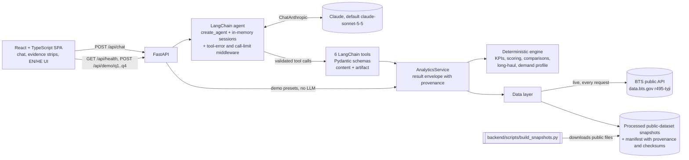

# Architecture: Airport Investment Intelligence Agent

**Status: final (submission version, 2026-10-31).** This document describes the system as implemented and tested.

## 1. Purpose and scope
Analysts at a firm that invests in US airport modernization ask questions in natural language. The agent answers with **evidence-based investment indicators** calculated from public US aviation data: demand growth, seat utilization, operational stress, route mix, and capacity-pressure signals.

What it deliberately does **not** do:
- **No profitability, ROI or capacity-gap estimates.** Public aviation data contains no costs, revenues or terminal capacity. Rankings are presented as *relative leads for further research*, not verified investment opportunities.
- **Unmet demand is not measured.** It is, by definition, demand that never materialized in the data. The agent shows observed demand and capacity-pressure indicators, and says plainly that unmet demand is not measured.

## 2. System overview



| Layer | Implementation | Responsibility |
|---|---|---|
| Frontend | React 19 + TypeScript + Vite (`frontend/src`) | Chat, session continuity, rendering of structured evidence, EN/HE interface, demo mode |
| Backend API | FastAPI (`backend/app/main.py`) | `/api/chat`, `/api/demo/{q1..q4}`, `/api/health`; serves the built SPA from one server |
| Agent | LangChain `create_agent` (`backend/app/agent`) | Interprets questions, chooses and calls tools, writes the explanation |
| Tools | `backend/app/agent/tools.py` | Thin, validated wrappers over the analytics service |
| Engine | `backend/app/engine` (pure Python, no LLM imports) | All KPI formulas, normalization, scoring, comparisons, long-haul shares, peer percentiles |
| Data layer | `backend/app/data` | Live BTS API client; snapshot loader; airport and region resolver; input validation; provenance |

## 3. Request flow and LangChain tool flow
1. React sends `{message, session_id}` to `POST /api/chat` (Vite proxies `/api` in development; FastAPI serves everything in production).
2. FastAPI calls `agent.ainvoke(...)` with the session's thread id. The `InMemorySaver` checkpointer gives the agent the conversation history, so follow-ups work.
3. The model chooses tools. **Pydantic schemas validate the arguments before any code runs**: airport-code pattern, threshold range, service-class enum, hub classes, list sizes.
4. Each tool calls one `AnalyticsService` method and returns two things:
   - **content:** a compact JSON view for the model, with display-ready values formatted from the registry units (rates and shares as percentages rounded once, half-up, from the full value; scores as "x/100"; minutes with units; counts with thousands separators). This is presentation only: no calculation changes;
   - **artifact:** the **unmodified** engine result envelope.

   The artifact is never sent to the model.
5. The model writes a short interpretation, not a copy of the evidence:
   - Length: 60–100 words, up to 130 for rankings and comparisons.
   - Form: plain prose, with no headings, bullet lists or closing offers.
   - Content: the conclusion first, then 2–4 key metrics, then one combined caveat sentence that keeps material warnings.
   - The evidence cards remain the authoritative detail.
6. FastAPI extracts **this turn's** tool artifacts and returns them with the reply. React renders the numbers from the artifacts, never from the prose.

### Tools
| Tool | Main inputs (validated) | Result type |
|---|---|---|
| `resolve_airports` | `query` (1–100 chars), `kind` (airport, region) | `airports`, including the interpretation (for example "LA" → LAX) |
| `rank_airports` | `region` or `airports` (3–30); optional `weights` (≥ 0, scoring metrics only); optional `hub_classes` (L, M, S, N) | `ranking` |
| `compare_airports` | `airports` (2–5, first is the baseline); optional `metrics` | `comparison` |
| `get_long_haul_share` | `airport`; `threshold_miles` 500–10,000 (default 3,000); `service_classes` ⊆ {F, G, L, P} (default F+L) | `long_haul` |
| `get_demand_pressure_profile` | `airport`; optional `peer_group` (hub class) | `demand_profile` |
| `list_metrics` | none | `metrics` (formulas, units, sources, rankability) |

### Where AI is used, and where it is not
| The LLM does | The LLM never does |
|---|---|
| Understand the question, resolve intent, pick tools and parameters (weights, hub filters, thresholds) | Compute, estimate or round metrics, scores, ranks or percentages |
| Handle follow-ups from conversation memory | Supply numbers from background knowledge |
| Explain results briefly, with the key caveat | Describe airports beyond tool output, claim profitability, or claim measured unmet demand |

The system prompt enforces grounding, the warning rules, the investment framing and concise answers. It **does not force a response language**: a Hebrew question gets a Hebrew answer.

## 4. Evidence contract and error handling
`POST /api/chat` returns a stable JSON contract:

```json
{"session_id": "uuid", "mode": "agent",
 "status": "complete | completed_with_tool_errors | incomplete",
 "reply_markdown": "...",
 "evidence": [{"tool": "...", "tool_call_id": "...", "input": {}, "status": "success | error",
               "artifact": {"result_type": "...", "data": {}, "provenance": [], "windows": {},
                            "definitions": {}, "warnings": [], "coverage_notes": [],
                            "confidence": "high | medium | low", "formula_version": "v1"}}],
 "sources": [], "warnings": [], "errors": [], "incomplete": false, "notice": null}
```

- `evidence`, `sources`, `warnings` and `errors` cover the **current turn only**. Memory stays server-side.
- **Small-sample warnings are kept at three levels:**
  1. `data.small_sample_airports` (structured);
  2. the top-level `warnings`;
  3. per-airport flags.

  So no downstream consumer can lose them.

| Failure | Behaviour |
|---|---|
| Invalid tool arguments | Rejected by the schema → error `ToolMessage` → the model corrects itself or explains; evidence item `status: error`; turn `status: completed_with_tool_errors` |
| Engine validation error (unknown region, bad weights) | The message is returned verbatim to the model and to `errors` |
| Other tool exceptions | Exception type only (no internal details) |
| Agent loops | Model calls are capped per request (`AGENT_MAX_MODEL_CALLS`, default 8) → `status: incomplete` with a clear note |
| BTS API timeout or error | 10 s timeout, 1 retry, 1 h in-memory cache, then a **labelled** recorded API copy if one exists; otherwise a clear error |
| Snapshots missing | HTTP 503 "Data snapshots unavailable … run build_snapshots.py" |
| No API key | HTTP 503 for chat; the UI switches to a labelled deterministic demo |
| Model failure | HTTP 502 with a reference id; the UI offers "Try again" |
| Session limits | 30 turns per session (HTTP 409), 2 h idle → new session with a notice; sessions are lost on restart |

## 5. Data sources, periods and reproducibility
| Data | Source | Access | Period | Used for |
|---|---|---|---|---|
| Monthly traffic per origin airport: passengers, seats, departures (all service classes), freight | BTS T-100 Segment Summary by Origin Airport (`data.bts.gov` r495-tyji) | **Live public API (SODA)**, called at request time | Latest 12 months vs the previous 12 (2025-08..2026-07 vs 2024-08..2025-07 at the time of writing) | Growth, load factor, volumes, Q4 2019 baseline |
| Departure delays, cancellations, taxi-out; arrival-delay causes | BTS Reporting Carrier On-Time Performance (TranStats monthly file) | Public dataset snapshot | 2026-07 | Delay-based congestion, pressure indicators |
| Route departures with distance and service class | BTS T-100 Segment, All Carriers (TranStats download form) | Public dataset snapshot | 2026-07 | Long-haul shares |
| Airport list, state, FAA region, hub class, enplanements | FAA CY2025 Commercial Service Enplanements | Public dataset snapshot | CY2025 (and CY2024) | Region resolution, eligibility, peer groups |

- **Verified data facts:**
  - The API totals equal the T-100 sums over all service classes (checked for ANC, SFO and SNA in two months), so **API departures include cargo-only flights**.
  - T-100 distances are **statute miles** (they match great-circle statute distances to within about 0.3% on 400 routes).
  - `DepDel15` is blank only for cancelled flights.
- **Provenance:** every result lists its source type (live API, recorded API copy, or dataset snapshot), source name, URL, retrieval time and observation period.
- **Reproducibility:** `backend/scripts/build_snapshots.py` downloads the public files into `data/raw/` (cached, stamped with the retrieval time), aggregates them into small CSVs in `data/processed/`, and writes `manifest.json` with SHA-256 hashes of the processed **and** raw files. Rebuilding from the cached raw files produces byte-identical outputs. The loader verifies the hashes at startup.
- **Distribution:** the minimal processed snapshots (four CSVs plus `manifest.json`, about 1 MB) are **committed**, so a fresh clone runs without the builder. Raw downloads and the recorded API copy are excluded; the recorded copy is optional and the loader skips it when absent. `.gitattributes` disables end-of-line conversion for these files, so their checksums verify on every OS (tested with Windows and Linux line-ending clones).
  - **Basis:** US federal statistics. BTS labels its T-100 datasets and its on-time performance products "Public Domain U.S. Government". The FAA enplanement table is an FAA compilation based mainly on DOT T-100 filings. No restrictive terms were found.
- **Freshness:** the application uses **dated historical snapshots** (July 2026 and CY2025), not real-time data. The live traffic API itself lags about 3 months behind.

## 6. Metrics
| Metric | Formula | Category |
|---|---|---|
| Passenger growth | Σ passengers (last 12 months) ÷ Σ passengers (previous 12) − 1 | Measured |
| Flight growth | Same on departures; **includes cargo-only flights** | Measured |
| Load factor | Σ passengers ÷ Σ seats over the last 12 months (seat-weighted) | Measured, used as a pressure **proxy**; airline seat utilization, **not** terminal utilization |
| Departure delay rate | flights with `Origin = X`, `Cancelled = 0`, `DepDel15 = 1` ÷ flights with `Origin = X`, `Cancelled = 0` and `DepDel15` present | Measured, used as a proxy; reporting carriers only |
| Cancellation rate | cancelled ÷ all scheduled rows | Measured |
| Taxi-out | mean `TaxiOut` of non-cancelled departures | Measured, used as an airside proxy |
| Long-haul share | departures on routes ≥ threshold (statute miles, inclusive) ÷ all departures, for **explicit** service classes; the all-class figure is always included | Measured, given the stated definitions |
| Peer percentile | % of same-hub-class peers with a strictly lower value (needs ≥ 3 peers) | Descriptive |
| Unmet demand | — | **Not measurable** with available data |

- **Missing data:** a missing month, zero denominator or uncovered airport makes the value `null` with a stated reason. **Nothing is imputed.**

## 7. Expansion-opportunity score (Q1-style rankings)
- **Candidates:** FAA primary commercial-service airports in the requested region or state, or an explicit list. An optional hub-class filter narrows the group **before** scoring, with the same methodology.
- **Default weights:** passenger growth **0.30**, load factor **0.25**, departure delay rate **0.20**, flight growth **0.15**, taxi-out **0.10**. Users can request other weights over the allowed metrics. Weights must be ≥ 0 with at least one > 0, are rescaled to sum to 1, and are echoed back.
- **Normalization:** min-max **within the candidate group**: `100 · (x − min) / (max − min)`, or 50 when all values are equal. All scoring metrics are "higher = stronger signal".
- **Usability and coverage:**
  - A KPI is used only if **at least 3 airports** have a value; otherwise it is dropped with a warning and the weights are rescaled.
  - Score = weighted average over the KPIs the airport has.
  - Coverage = the share of weight that is available.
  - **Coverage < 60% → listed as insufficient data, not scored.**
  - Fewer than 3 ranked airports → no ranking (a raw comparison is shown instead).
- **Small samples:** operational KPIs from fewer than **300 eligible departures** in the month are kept but flagged `low_sample`. They are **never excluded**.
- **Ties:** broken by 12-month passengers, then airport code.
- **Explainability:** every airport shows its raw value, normalized value, weight and contribution for each KPI, plus coverage and flags.
- **Interpretation (shown with every ranking):** scores are relative to the group, so adding or removing airports can change the order. Scores with different coverage are not perfectly comparable. A high score is a lead for further research, not a verified opportunity, a profitability forecast, or proof of a terminal capacity shortage.

## 8. How the four assignment questions are handled
| Question | Treatment |
|---|---|
| New England terminal-expansion candidates | Region → FAA region NE, 16 primary airports → expansion-opportunity ranking |
| LA vs Santa Ana congestion | "LA" → LAX and "Santa Ana" → SNA, stated → side-by-side delay rate, cancellations, taxi-out and volumes, with differences vs the first airport; no composite score |
| Anchorage long-haul percentage | T-100 routes ≥ 3,000 statute miles, passenger classes (F+L) by default, **plus the all-class figure**, because cargo is a large share at ANC |
| SFO unmet demand and why | Three parts: observed demand (incl. vs 2019), capacity-pressure indicators with peer percentiles, and **"unmet demand: not measured"**; the "why" uses arrival-delay causes, phrased as evidence *consistent with* pressure |

These are evaluation scenarios, not hard-coded paths. The same tools answer analogous questions for other airports, states and regions.

## 9. Frontend
- **Evidence strips:** each tool result is shown as a "flight strip". The header holds the analysis, data windows and confidence; the body holds the typed views (ranking table with score bars and badges, comparison with numerator/denominator and differences, long-haul figures and class and distance breakdowns, demand profile); the footer holds the warnings, coverage notes and sources.
- **Language:** an `EN | עברית` toggle translates only the static interface, using a typed dictionary.
  - Hebrew uses right-to-left layout through logical CSS properties.
  - The AI's replies and backend-generated text are shown as received.
  - A note appears when the reply language differs from the interface language.
  - Switching language never resets the conversation.
- **Demo mode:** without an API key, four preset buttons call `/api/demo/{q1..q4}`, which runs the same engine without an LLM. The mode is clearly labelled, and free-form chat is disabled.

## 10. Security and reliability
- Secrets live only in a gitignored root `.env`. No key appears in the repository or its history.
- Airport codes are validated before any API query is built. The LLM has no generic HTTP, file or code tools.
- Recoverable failures return clear statuses (see §4). Paid model tests are opt-in only (`RUN_LLM_TESTS=1`).

## 11. Testing
| Suite | Scope |
|---|---|
| Backend offline (`pytest`) | KPI formulas and edge cases, scoring (including worked examples), comparison, long-haul, peer percentiles, data parsers and validation, BTS client (mocked HTTP), tools, agent mechanics with a scripted fake model, `/api/chat` contract (sync and async), errors, limits, sessions, prompt guards, contract-fixture drift |
| Backend live (`pytest -m live`) | Real BTS API plus the real snapshots: the four scenarios as invariant checks (not hard-coded answers) and other regions |
| Paid (`RUN_LLM_TESTS=1 pytest -m llm`) | Real model: tool calling, memory, the four scenarios plus a follow-up |
| Frontend (`npm test`) | Every evidence view rendered from backend-generated fixtures (numbers must equal the artifacts), statuses, errors and retry, sessions, duplicate-submit guard, demo mode, EN/HE switching and RTL |

## 12. Key tradeoffs and what was deliberately not built
| Choice | Why | Cost or risk accepted |
|---|---|---|
| Hybrid data: live BTS API + small public snapshots | The only keyless live API covers traffic; delays and routes exist only as public files | Two data paths; snapshots need a builder |
| Deterministic engine + LLM orchestration | Reproducible, testable numbers; the LLM only explains | Every derived figure must be a tool output |
| LangChain `create_agent` | Agent loop, schema validation, memory and middleware without custom plumbing | Dependency and abstraction; behaviour verified by tests |
| Min-max within the candidate group | Transparent, nothing invented | Scores are relative to the group |
| Keep small samples, flagged | Does not hide small airports | Noisy delay rates can rank high, so they are flagged everywhere |
| One-month operational data | Fits the time budget and download sizes | Seasonality |
| Artifacts rendered directly by React | On-screen numbers never pass through the LLM | Model prose could still contain an unsupported remark; it is prompt-guarded |

**Deliberately not built:**
- databases, Redis, RAG or vector stores;
- custom LangGraph graphs or microservices;
- voice, authentication or persistence of sessions;
- a generic calculator tool (deferred; follow-ups that need ad-hoc aggregation get "not available");
- ranking-change summaries;
- profitability or capacity modelling.

## 13. Known limitations
- Operational data covers **one month** and **reporting carriers only**; cargo carriers are absent from the delay data.
- Flight growth includes cargo flights. Load factor reflects airline choices, not terminal use.
- No terminal or gate capacity data; unmet demand is not measured.
- The T-100 download depends on a public web form that could change. The on-time file is large (about 33 MB per month).
- Sessions are in memory and single-process.
- Snapshots are dated, and there is no automatic refresh (see §14).

## 14. Future improvements
- **Automated monthly data refresh (deliberately deferred, time-boxed assignment):** a scheduled job would:
  1. poll the sources' publication dates (the BTS TranStats "latest available data", the FAA annual release);
  2. download only new periods;
  3. validate the schema (expected columns), data quality (row counts, totals cross-checked against the live API for the same month, no impossible values) and the manifest;
  4. build the new snapshot in a staging directory;
  5. **atomically** swap it in only after validation succeeds.

  On any failure, the **last known good snapshot** stays in service and an alert is raised. This needs no change to the engine: the loader already verifies manifest checksums and reports periods.
- More operational months (seasonality) and more peer context.
- Persistent sessions for multi-user deployment.
- A generic aggregation tool over evidence references, for follow-ups such as averages across airports.
